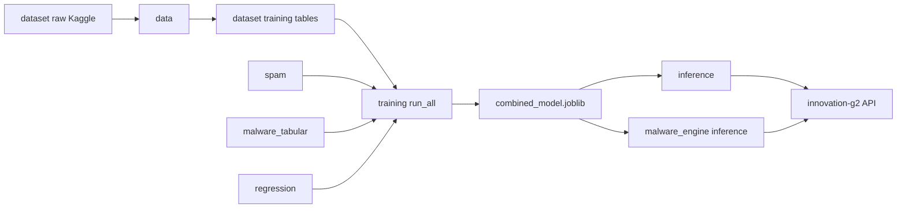

# Spam, Malware and Process Detection

Three machine-learning tasks in one project, trained on open data from Kaggle
and served by a small FastAPI app.

| task | method | question | score |
| --- | --- | --- | --- |
| spam classification | TF-IDF words + character n-grams, Logistic Regression (best of 8 settings) | is this message spam? | F1 0.979, 0.912 on an unseen source |
| malware classification | calibrated HistGradientBoosting (or TF-IDF + Logistic Regression for text platforms), one model per platform | is this file malware? | see `artifacts/malware/malware_results.json`; the honest leave-one-source-out F1 is the headline number |
| spam clustering | K-Means on SVD of the TF-IDF (compared with a Gaussian mixture and Ward clustering) | do the messages group by themselves? | purity 0.748, ARI 0.245 |
| process regression | HistGradientBoosting on 20 process counters (compared with Ridge) | how many context switches? | R2 0.979, MAE 742 (grouped 5-fold) |

**Intended users:** people who receive suspicious messages (students, office
staff) and the security staff who check files for them. The spam model returns
the words behind its verdict, so a non-expert can see why a message looks bad.

## 1. Set up the environment (conda)

```bash
conda env create -f spam_malware_detection_model/environment.yml
conda activate spam-malware
```

The environment has Python 3.12 with pandas, numpy, scikit-learn, matplotlib,
joblib, fastapi and uvicorn, plus httpx and pytest for the tests. If conda is
not available, the same packages work in a plain virtual environment:

```bash
python3.12 -m venv .venv && source .venv/bin/activate
pip install pandas numpy scikit-learn matplotlib joblib fastapi "uvicorn[standard]" httpx pytest pefile androguard PyMuPDF loguru
```

## 2. The data

Everything the models read is in `dataset/`. The raw Kaggle downloads sit in
one folder per author, and each training file sits in the folder of the author
whose raw download it came from.

| file | what it is |
| --- | --- |
| `spam_train_dataset.csv` | merged raw spam: 232,430 rows from 8 corpora |
| `spam_train_clean.csv` | what the spam model trains on, made by step 4: 87,798 rows |
| `malware_pe_windows.csv` | Windows PE header features, 39,669 rows, with a `source` column naming the file each row came from (never a feature) |
| `saurabhshahane/malware_android_drebin.csv` | Android API/permission features, 7,257 rows |
| `ankit1743/malware_android_permissions.csv` | Android permission features, 7,379 rows |
| `joebeachcapital/malware_android_tuandromd.csv` | Android feature flags, 660 rows |
| `dataset/<platform>.csv` | one normalized table per additional platform; see the platform list below |

### Malware platforms (all datasets are from Kaggle)

`build_datasets.py` writes one CSV per key in `config/paths.py: MALWARE_DATA`. Each
table holds numeric features, a `source` column for leave-one-source-out
scoring, and a 0/1 `label`. Text platforms hold `text,source,label` instead.

| OS / case | platform keys | Kaggle source |
| --- | --- | --- |
| Windows PE / memory / API / ransomware | `pe_windows`, `windows_pe_2`, `windows_pe_3`, `windows_memory`, `windows_api_dynamic`, `windows_api_args`, `windows_ransomware` | `joebeachcapital`, `mauricio`, `greenwarbler`, `saurabhshahane`, `luccagodoy`, `ang3loliveira`, `bishwajitprasadgond`, `oriolakolawole` |
| iOS | `ios_mobile` | `krishna1502/pegasus-spyware-attacksynthetic-dataset` |
| Linux / Unix / embedded / RTOS | `linux_elf`, `embedded_firmware`, `iot_linux`, `iot_embedded_linux`, `iot_freertos`, `iot_openwrt`, `iot_network`, `network_attacks` | `sanjayrohith`, `datamunge`, `ahmadzulfiqar001`, `gundalaxmisai`, `nkongolo` |
| Android | `android_drebin`, `android_permissions`, `android_tuandromd`, `android_permissions_2` | `saurabhshahane`, `ankit1743`, `joebeachcapital`, `dannyrevaldo` |
| Office / PDF documents | `pdf_cic`, `pdf_cic_2`, `pdf_efs`, `pdf_evasive` | `satyaprakash138`, `kk0105`, `dooschoi`, `fouadtrad2` |
| Scripts / shellcode | `script_javascript`, `script_shellcode` | `fanbyprinciple`, `thedevastator` |
| Web / URL | `web_websites`, `url_features`, `url_features_2`, `url_text` | `xwolf12`, `ndarvind`, `sahandnamvar`, `sid321axn` |

Every raw download's exact `kaggle datasets download -d <ref>` command is in
its folder's `INFO.md`. Large Kaggle CSVs are sampled reproducibly (see the
`INFO.md` and `.gitignore`); no data is invented and no source outside Kaggle
is used.

### Detection improvements

Each platform compares a linear baseline with a tree model. The winner is
chosen on leave-one-source-out F1 when the platform has more than one source,
otherwise on grouped F1 from `GroupKFold` (never on random CV). The shipped pipeline is wrapped in
`CalibratedClassifierCV` (isotonic, or sigmoid for small/text platforms), and
its decision threshold maximizes out-of-fold F-beta(2) so recall is favoured.
`artifacts/malware/malware_results.json` reports CV F1, test F1, LOSO F1, threshold,
calibration method and Brier score per platform. The threshold is now chosen
from the out-of-fold probabilities of the calibrated model on the training rows,
subject to out-of-fold precision staying at or above 0.5; when no threshold
reaches that, the F1-optimal threshold is used. `calibrated_test` holds the
accuracy, precision, recall and F1 of the hold-out calibrated model at that
shipped threshold (the rule the product applies); the combined confusion matrix
and the Brier score come from a model fitted on the training rows only.
`data_warnings` lists single columns that separate the classes on their own and
sources that hold one class only. It also reports a source AUC: how well the
features predict the `source` column (for one-source tables, how well they
predict a random half of the row clusters against the other half). A high
value means the score may reflect the corpus rather than the file.

### C1: weak platforms (grouped-F1 comparison)

Five weak platforms were retuned with the same `build_groups` clusters and
seed for baseline and every variant; a change was kept only if grouped F1 rose
by at least 0.01 and `trust` did not change. The settings live in
`malware_tabular/candidates.py:PLATFORM_EXTRAS` as plain constructor overrides,
so no new feature columns are needed and the saved bundle and inference path
are unchanged. Grouped F1 before -> after for the kept winner, with other
tried variants in parentheses:

| platform | kept winner | other variants tried (grouped F1) |
| --- | --- | --- |
| `embedded_firmware` | class_weight balanced + 15 leaves 0.470 -> 0.583 | balanced alone 0.558; weights 1:3 0.526-0.576; 20/25 leaves 0.572/0.550; l2=5 0.580 (balanced) / 0.445 (plain); leaves 15/7/63 0.401/0.350/0.452; LogReg 0.444; balancing unchanged; extra log/ratio features 0.470/0.378 |
| `web_websites` | class_weight balanced + 7 leaves 0.506 -> 0.577 | 7 leaves 0.541; 5/9 leaves 0.526/0.534; weights 1:3 0.523; balanced 0.523; extra ratio features 0.557; leaves 15/l2=5/lr=0.03 0.519/0.479/0.515; LogReg 0.413; balancing unchanged |
| `ios_mobile` | 7 leaves 0.810 -> 0.821 | weights 1:3 0.821; 5/9 leaves 0.821/0.819; l2=5 0.814; lr=0.03 0.817; balanced weights 0.568; LogReg 0.604; balancing/extra features unchanged |
| `windows_ransomware` | class_weight balanced + 7 leaves 0.673 -> 0.689 | balanced alone 0.679; l2=5 0.683; balanced + l2=5 0.688; weights 1:3 + 15 leaves 0.682; 15 leaves 0.672; LogReg 0.555; balancing unchanged; ratio features 0.625 |
| `script_shellcode` | LogReg C=5 0.356 -> 0.472 (LOSO 0.823 -> 0.849) | C=10 0.451; C=3 0.400; C=20 0.446; char 2-5 0.390-0.447; C=0.1 0.294; no class_weight 0.260; word n-grams 0.109; min_df 1/2 0.344/0.341 |

The bundle and `malware_results.json` were retrained with these settings. Trust
was checked on the same groups: all five platforms remain `suspect`, unchanged.

How much of each gain can be believed. A grouped score depends on which clusters
happen to be held out, so each claim was re-run on six different clusterings
(different seeds):

| platform | result over six clusterings | reading |
| --- | --- | --- |
| `embedded_firmware` | balanced 15 leaves beats the plain tree in 6 of 6, mean +0.088 (standard deviation of the score 0.012) | a real gain |
| `script_shellcode` | C=5 beats C=1 in 4 of 6, mean +0.033; a different n-gram setting (`char_wb` 2-5) ties the shipped one (mean -0.001, better in 2 of 6) | within noise; do not report it as an improvement |

`script_shellcode` has a ceiling that tuning cannot lift. Its label is derived from
the written description of each snippet, not from the code: a snippet is "risky"
when its description contains words such as `decode`, `exec` or `shell`. Of 3,200
snippets, 252 (7.9%) have a label that disagrees with the code, and a quarter of
the snippets whose code contains `int 0x80`, `syscall`, `execve` or `/bin/sh` are
labelled benign. Most snippets are a single instruction (median 13 characters).
Further tuning would fit that labelling rule rather than shellcode, so it was
stopped; its score is a measure of the label, not of detection.

Two other models were tried on `embedded_firmware` and kept out: a random forest
(0.466, worse than the plain tree) and extra trees (0.529, better than the plain
tree but below the shipped 0.583).

### Honest score block

Every platform in `artifacts/malware/malware_results.json` carries an `honest`
block with `cv_f1`, `group_f1`, `cross_source_f1` (only for platforms with
several sources, using the mean leave-one-source-out F1), `source_auc`, `trust`
and `reasons`. `group_f1` comes from `GroupKFold` over clusters of similar
rows: a fold with a single class on either side is skipped and counted under
the candidate's `group.skipped` key. The same block is exposed on each malware
entry in `predict.model_info()` (`malware_group_f1`, `malware_trust`) and on
each `predict_malware()` reply (`group_f1`, `trust`).

`trust` is `ok`, `suspect` or `unmeasurable`. It is `suspect` when CV F1 exceeds
group F1 by more than `GROUP_GAP_SUSPECT` (0.05) or when source AUC exceeds
`SOURCE_AUC_SUSPECT` (0.9); it is `unmeasurable` when no grouped score could be
computed. A cross-table F1 more than `GROUP_GAP_SUSPECT` below CV F1 also marks
`trust` as `suspect`. Both thresholds are starting values in
`config/constants.py`, not measured conclusions. `predict_malware` still returns
the existing reply keys; `group_f1` and `trust` are additional.

### Cross-table scores

Several platforms are different Kaggle tables of the same problem (PDF,
Android, URL and Windows PE groups). `malware_tabular/cross_table.py` trains
the HistGradientBoosting candidate on one table and scores it on another,
using only columns the two tables share after case/underscore normalisation;
no columns are guessed or silently dropped. `artifacts/malware/malware_results.json`
records every `train->test` pair under top-level `cross_table`, including
skipped pairs with their reason. A pair is skipped when it has fewer than
`MIN_COMMON_COLUMNS` (8) shared columns or either side has a single class. A
platform's `honest.cross_source_f1` is its mean F1 as the held-out table,
filled in only when no leave-one-source-out score already exists. These scores
show how much of a platform's cross-validation F1 survives a change of corpus.

`script_javascript` carries the one-class source warning: ("sources with one class only: JavascriptSamples,
JavascriptSamplesObfuscated"), so its 0.978 cv F1 partly reflects which folder a
file came from and should be read with that caveat. `url_features` now uses
sigmoid calibration instead of isotonic, because its isotonic probabilities
saturated at exactly 0 and 1 (threshold was 1.0, only exact training rows were
flagged); its threshold is now 0.9163. `build_datasets.py` caps the majority
class at 4x the minority class for `embedded_firmware` and `linux_elf`, whose
malware share was 2.2% (their F1 moved from 0.365 to 0.687 and from 0.983 to
0.981). It also leaves `Risk_Score` out of the IoT tables because it separates
benign (0-20) from malware (70-100) perfectly; the IoT F1 is 0.987 to 0.999.
`predict.predict_malware` and POST /api/malware now return `low_information`:
when more than half of the features were filled with training medians and the
verdict is the one the model gives with no input, a MALWARE reply becomes
`SUSPICIOUS` and carries a `note`.

An extra ML implementation, `bundle["malware"]["os_classifier"]`, predicts a
threat sample's OS / file type from the Kaggle MalwareBazaar feed. It is
available from Python as `predict.predict_os(text)`.

### Layered file scanner

`malware_engine/` adds a second, independent malware path that judges **raw
file bytes** rather than a named feature table. `POST /api/scan/upload` routes
on magic bytes (PE / ELF / Mach-O / APK / IPA / PDF / OOXML / OLE / script /
archive / unknown), then returns one of four verdicts: `MALWARE`,
`SUSPICIOUS`, `BENIGN`, `CANNOT_ASSESS`. Every reply carries `format`,
`deciding_layer`, `coverage_tier` (`specialist` / `fallback` / `rules-only`),
`evidence`, `model_version`, `schema_version` and `sha256`. Rules can only
raise a verdict, never lower it.

`artifacts/malware/coverage.json` is the measured scoreboard written by
`python -m malware_engine.training.train_pipeline` and served by
`GET /api/malware/coverage`. A format earns `specialist` only when its
measured gates pass (beats the always-malware baseline, detection at a 1%
false-alarm target, false alarms under shift, evasive set, extractor parity,
source identification). Gates the Kaggle data cannot measure are recorded as
"unmeasured", never as a pass; a failed or unmeasured gate caps the format at
`fallback`, whose alarms stop at `SUSPICIOUS`.

Specialists for PE, PDF and APK are trained **only on Kaggle tables already in
`dataset/`**. The EMBER 2018 v2 parquet files were deliberately not
downloaded, so the PE specialist uses plain `pefile` header columns, and the
time-split and independent-clean-source gates are reported as unmeasured.
ELF, Mach-O, IPA, Office and script formats have no Kaggle corpus of
recomputable raw bytes, so they are `rules-only`. Those operating systems are
still covered by the 30 tabular platforms above.

The two meanings of coverage are stated explicitly: the 30 platforms cover an
OS / feature table through `POST /api/malware`, and the scoreboard covers a
raw uploaded file format through `POST /api/scan/upload`.

From Python: `predict.predict_scan(data, filename)`, `predict.scan_coverage()`,
`predict.scan_info()`. The original PDF-text-to-spam upload path is preserved
at `POST /api/spam/upload`.

The spam and regression models are byte-for-byte unchanged by both malware
paths. The existing Malware tab still uses `POST /api/malware`; it now shows
the `note` that explains a weak verdict.

A platform table lives next to the raw download it was built from. Three files
stay at the top of `dataset/` because they merge more than one author's data:
the two spam files combine three authors, and `malware_pe_windows.csv`
combines two.

Two of these files are **not** in git, because they are too large for GitHub:
`spam_train_dataset.csv` (232 MB) and `spam_train_clean.csv` (88 MB). Both are
in the Hugging Face dataset linked at the end of this section, and both are
rebuilt by steps 3 and 4 below, so a fresh clone can regenerate them from the
raw downloads.

| Raw file | Used for |
| --- | --- |
| `nsaravana/Malware dataset.csv` | Linux process counters for the regression task, 100,000 rows, used as downloaded |

Label: `1` = spam / malware, `0` = ham / benign. In the process file the target
is a count (`nvcsw`), not a class.

Where each download came from, with its license, is in `dataset/INFO.md` files
and in `dataset/Kaggle datasets source.md`. Eight spam corpora and thirty
malware platforms are used; the sources were downloaded with the Kaggle
command line tool, for example:

```bash
kaggle datasets download -d naserabdullahalam/phishing-email-dataset --unzip -p dataset/naserabdullahalam
```

## 3. Build the training files from the raw downloads

```bash
cd spam_malware_detection_model
python -m data.build_all
```

This one script does all the merging, so the numbers in the report can be
reproduced. It writes the spam files and the thirty malware tables listed
above, and prints how many rows it dropped at every step. What it does:

- Spam: reads eight corpora, pastes the email subject in front of the body,
  then drops texts that appear twice. Two files listing the same text with
  different labels are dropped, because a text cannot be both.
- Malware: builds one table per platform. The four Kaggle sets label their
  rows differently (`Type` as a family number, `Malware` as 0/1, `class` as
  B/S, `Label` as the words malware/goodware, `Result` as 0/1), so each is
  mapped to 0/1 and checked. Rows whose feature values repeat are dropped;
  when a repeated group disagrees about the label the majority vote wins and a
  tie drops the whole group. The Windows table merges two Kaggle files and
  records in `source` which one a row came from, so that the training script
  can train on one file and score on the other.
- Process: nothing to build. The Kaggle download is used as it is, and its
  `hash` column identifies the process so that the data can be split properly.

The platforms are written to separate files on purpose. They use different
columns, so a single table would be mostly empty cells, and a model trained on
that table learns which columns are filled, which is the same as learning the
answer.

## 4. Clean the spam text

```bash
python -m data.clean_spam
```

Four steps, each aimed at a problem found by testing on data the model had not
seen:

1. Scrub source clues: links become `urltoken`, e-mail addresses become
   `emailtoken`, numbers become `0`, and quoted-reply lines, month names and
   years are removed. Without this the strongest "ham" words were `enron` and
   `wrote`, which identify the corpus rather than the message. The scrub is
   `scrub()` in `common/textclean.py`; `inference/spam.py` imports the same function, so a
   message is cleaned the same way when it is scored as when the model was
   trained. Month names are matched as whole words, so "junk", "market" and
   "decision" keep their letters.
2. Drop empty texts and texts carrying two labels.
3. Drop duplicates (the Kaggle email corpora overlap heavily). This runs after
   the scrub, because scrubbing turns many different messages into the same
   text, and a copy of a training message in the test split inflates the score.
4. Keep at most `MAX_PER_CLASS` rows per source per label, so one big corpus
   cannot decide what "spam" means. The cap is 10,000; raising it from 5,000
   moved the leave-one-source-out score from 0.898 to 0.902 (measured on an
   earlier version of the cleaning; the final score is in the results below).

At the end it prints the row count per source and writes
`dataset/spam_train_clean.csv`. It also saves the spam share each source had
before step 4 balanced it (`artifacts/spam/spam_natural_shares.json`), which the training
script uses to estimate precision on the class mix each source really has.

## 5. Look at the data

```bash
python -m data.analyze
```

Writes five figures, each into the folder of the model it describes
(`artifacts/spam/figures/`, `artifacts/malware/figures/`, `artifacts/regression/figures/`): messages per
source, message length, samples and malware share per platform, the words the
spam model leans on, and the distribution of the regression target with the
counters that track it. Run step 6 first, because two figures read the saved
results.

## 6. Train and evaluate every model

```bash
python -m training.run_all
```

Takes several minutes, mostly the spam comparison, which trains eight settings
eight times each (once per source held out). Each model's results land in its
own folder, so one folder holds the code, the scores and the plots for one model:

| file | content |
| --- | --- |
| `combined_model.joblib` | all three models in one bundle (keys `spam`, `malware`, `regression`) |
| `artifacts/spam/spam_cv_results.json` | spam test split, 5-fold CV, leave-one-source-out, the 8-setting comparison, precision at the natural class mix, the clustering comparison |
| `artifacts/spam/spam_feature_importance.json` | the 20 strongest spam and ham words |
| `artifacts/spam/spam_confusion_matrix.png` | spam confusion matrix |
| `artifacts/malware/malware_results.json` | both models scored on every platform, with honest cross-source results |
| `artifacts/malware/malware_clustering.json` | label-free K-Means / Gaussian mixture purity and ARI per platform, plus eight-cluster family shares |
| `artifacts/malware/malware_confusion_matrix.png` | malware confusion matrix |
| `artifacts/regression/regression_results.json` | both regression models: grouped and random split, grouped 5-fold CV, and the score without the strongest counter |

Every model is scored on data it never trained on. The spam model is also
scored leave-one-source-out: train on seven corpora, test on the eighth, which
is the honest test for a message from somewhere new. The regression split is
grouped by process, because all 1000 snapshots of one process belong together.

The spam setting that ships is the one with the best unseen-source F1: the
baseline stays unless another setting beats it by 0.002. The regression model is
chosen on the grouped 5-fold R2, because a single grouped split holds only 20
processes.

## 7. Predict

```bash
# a message
python spam_malware_detection_model/predict.py "URGENT: verify your account now"

# a file, for one platform
python spam_malware_detection_model/predict.py --malware pe_windows '{"NumberOfSections": 4}'
# a text platform takes a string instead
python spam_malware_detection_model/predict.py --malware url_text '{"text": "http://login.example.com/verify"}'
# the extra OS / file-type classifier
python spam_malware_detection_model/predict.py --os 'macho AmosStealer'

# a process
python spam_malware_detection_model/predict.py --process '{"utime": 350000, "map_count": 24}'

# what is inside the bundle
python spam_malware_detection_model/predict.py --info
```

From Python:

```python
import sys
sys.path.insert(0, "spam_malware_detection_model")
import predict

predict.predict_spam("WIN a FREE prize now!")
predict.malware_platforms()                    # ['android_drebin', 'android_permissions', ...]
predict.malware_feature_names("pe_windows")    # the columns this platform accepts
predict.predict_malware("pe_windows", {"NumberOfSections": 4})
predict.predict_process({"utime": 350000})
```

A message is cleaned with the training scrub before it is scored (links, numbers
and dates become the tokens the model learned). A column left out of a malware or process sample is filled with the training
median, and the reply says how many columns were filled, so a weak answer is
visible as a weak answer. A sample that names no known column is refused with
an error, because its answer would come from medians alone. The process answer
is held inside the range of the training target (`"clipped": true` says so),
because a model can answer outside anything it saw.
A spam text with no word the model knows is refused for the same reason.

## 8. Run the web service

The service has tests: `cd innovation-g2 && python -m pytest test_api.py`. The
model code has its own: `cd spam_malware_detection_model && python -m pytest`
(text cleaning, the evaluation helpers, and that prediction cleans text the way training did).

```bash
cd innovation-g2
python main.py
```

Then open <http://127.0.0.1:3000/> for the page and
<http://127.0.0.1:3000/docs> for interactive documentation.

The page is the React front end in `frontend-react/`. It is served from
`frontend-react/dist/` when that folder has been built (`npm run build` in
that folder); without a build, `/` returns 503 and the API is still available.
For development, run the front end on its own with `npm run dev` and
leave the back end on port 3000; the dev server proxies the API calls to it.

| method | endpoint | body | answer |
| --- | --- | --- | --- |
| POST | `/api/spam` | `{"text": "..."}` | verdict, probability, suspicious_words, safe_words |
| GET | `/api/malware/platforms` | | list of platform names |
| GET | `/api/malware/features` | `?platform=pe_windows` | the columns a platform accepts |
| POST | `/api/malware` | `{"platform": "pe_windows", "features": {...}}` | verdict, probability, platform, model |
| POST | `/api/process` | `{"features": {...}}` | predicted context switches |
| GET | `/api/process/features` | | the counters the regression model reads |
| GET | `/api/model` | | what is inside the saved bundle |
| GET | `/api/health` | | service and model readiness |

An empty text or an unknown platform answers `400` with a message; a body with
a missing or wrongly typed field answers `422`.

## Results

Spam, 87,798 messages from 8 sources, Logistic Regression on word and character
n-gram features:

| test | F1 |
| --- | --- |
| 20% hold-out split | 0.979 |
| 5-fold cross-validation | 0.979 ± 0.002 |
| mean over unseen sources (leave-one-source-out) | 0.912 |

The eight settings compared, by mean F1 on unseen sources:

| setting | unseen-source F1 |
| --- | --- |
| Logistic Regression, words + character n-grams (shipped) | **0.912** |
| Logistic Regression, 20000 words, C = 3 | 0.898 |
| Logistic Regression, 20000 words + word pairs | 0.897 |
| Logistic Regression, 20000 words (baseline, C = 1) | 0.892 |
| Logistic Regression, 20000 words, source words removed | 0.890 |
| Logistic Regression, 20000 words, C = 0.3 | 0.886 |
| Logistic Regression, 3000 words | 0.878 |
| Complement Naive Bayes, 3000 words | 0.865 |

The test sets are balanced, which flatters precision wherever spam is the
smaller class. Using the spam share each source had before balancing, the
precision on the real class mix is:

| unseen source | real spam share | F1 on balanced test | precision at real share |
| --- | --- | --- | --- |
| email_ling | 16% | 0.984 | 0.895 |
| email_ceas | 47% | 0.967 | 0.961 |
| email_enron | 49% | 0.970 | 0.981 |
| email_phishing | 53% | 0.956 | 0.944 |
| email_spamassassin | 28% | 0.891 | 0.869 |
| sms_master | 9% | 0.816 | 0.572 |
| sms_smishing_kaggle | 40% | 0.803 | 0.663 |

Where spam is rare, as in ordinary SMS traffic, most spam flags would still be
wrong, but the character n-grams cut the number of wrong flags from about six
in ten to about four in ten.

Malware, 3-fold cross-validation F1 on at most 12,000 rows per platform, best model per platform:

| platform | rows | Logistic Regression | HistGradientBoosting |
| --- | --- | --- | --- |
| pe_windows | 12,000 | 0.948 | **0.989** |
| android_drebin | 7,257 | 0.917 | **0.949** |
| android_permissions | 7,379 | 0.917 | **0.928** |
| android_tuandromd | 660 | 0.821 | **0.861** |

The two Windows source files hold very different mixes (windows_malwares is 92%
malware, pe_files_malwares 70%). Training on one file and scoring on the other:

| trained on | scored on | rows scored | Logistic Regression F1 | HistGradientBoosting F1 |
| --- | --- | --- | --- | --- |
| windows_malwares | pe_files_malwares | 4,943 | 0.761 | 0.711 |
| pe_files_malwares | windows_malwares | 7,057 | 0.739 | 0.892 |

The 0.989 above is a random split, where both files sit on both sides. On a
file from a new source the score is 0.71 to 0.89.

Clustering: K-Means with 2 clusters, given no labels at all, reaches purity
0.748 and an adjusted Rand index of 0.245. Purity alone would look better than
the clustering deserves, which is why both are reported, and purity can only
rise as clusters get smaller. Compared on the same 50 SVD numbers per message:

| algorithm | purity | ARI | silhouette |
| --- | --- | --- | --- |
| K-Means, 2 clusters | 0.748 | 0.245 | 0.056 |
| K-Means, 3 clusters | 0.752 | 0.203 | 0.054 |
| K-Means, 4 clusters | 0.827 | 0.272 | 0.068 |
| K-Means, 6 clusters | 0.865 | 0.244 | 0.086 |
| K-Means, 8 clusters | 0.880 | 0.210 | 0.118 |
| Gaussian mixture, 2 clusters | 0.644 | 0.082 | 0.038 |
| Ward clustering, 2 clusters (8,000-message sample) | 0.645 | 0.083 | 0.029 |

K-Means is the best of the three. Its two clusters are not spam against ham:
cluster 0 (42,599 messages, 26% spam) is led by `know`, `enron`, `message`,
`list`, `wrote`, `thanks`, which is the tone of work e-mail; cluster 1 (45,199
messages, 76% spam) is led by `urltoken`, `free`, `click`, `offer`, `today`, the tone
of promotion. The grouping follows the kind of text and partly the source
corpus, which is why it is a weak detector.

Malware is clustered the same way in `malware_tabular/clustering.py`: numeric
tables are signed-log scaled (0/1 for flag tables), reduced to at most 20 PCA
dimensions, then split into two groups by K-Means and by a diagonal Gaussian
mixture on the same features, with no label used to fit. `cluster_all()` skips
text platforms, caps each table at 12,000 rows and writes
`artifacts/malware/malware_clustering.json` through `write_clustering()`; the
hook in `training/run_all.py` is report-only and never changes the bundle. Each
report gives purity and adjusted Rand index against benign/malware, plus a
separate eight-cluster pass listing each group's size and malware share. Clusters
with a malware share between 0.05 and 0.95 count as `missed_family_clusters`:
these mixed groups are where a supervised model is most likely to miss a family.

Regression, predicting `nvcsw`:

| model | grouped 5-fold R2 | grouped 5-fold MAE | R2 without `utime` | R2 random split |
| --- | --- | --- | --- | --- |
| HistGradientBoosting (shipped) | **0.979** ± 0.009 | **742** | 0.946 | 1.000 |
| Ridge | 0.963 ± 0.026 | 1,058 | 0.933 | 0.980 |

A model that always answered the training mean scores R2 −0.444 on the grouped
split, which is worse than no model, because the held-out processes have a
different average from the training ones. The random-split column shows why the
split is grouped: HistGradientBoosting scores a perfect 1.000 there by
memorising which process a snapshot belongs to. `utime` (CPU time) tracks the
target most closely (correlation 0.946); without it the score drops by 0.03 to
0.04 but stays above 0.93, so the model does not rest on that one counter.

The boosting model grows shallower trees than scikit-learn's default (15
leaves instead of 31, 300 rounds instead of 200). It reads the 20 counters
that vary in the data; the 11 that never change are left out. The counters of
one process
move together, so a deep tree can fit a single process and then score its
neighbours badly. The smaller tree measured better on the grouped split: MAE
742 against 815, and 722 against 859 on the single grouped hold-out.

### C2: SMS experiments (measured, leave-one-source-out)

The design's C2 tried three families on the same LOSO plus `at_natural_mix`
scoring as the shipped model (baseline: `sms_smishing_kaggle` F1 0.803, FPR
0.290; `sms_master` precision at its 9% natural spam share 0.574; mean email
F1 0.953). Numbers below come from `/tmp/spam_c2_experiment.py`,
`/tmp/spam_c2_branch.py` and `/tmp/spam_c2_experiment_c.py`; a variant was kept
only if all three SMS numbers improved and mean email F1 fell by at most 0.005.

| variant | smish F1 | smish FPR | master nat. prec. | mean email F1 |
| --- | --- | --- | --- | --- |
| baseline (words + char n-grams) | 0.803 | 0.290 | 0.574 | 0.953 |
| shape features appended to TF-IDF | 0.801 | 0.289 | 0.639 | 0.955 |
| short cut 160 chars, penalty 0.35 | 0.799 | 0.233 | 0.615 | 0.953 |
| short cut 160 chars, penalty 0.60 | 0.792 | 0.194 | 0.676 | 0.952 |
| SMS-only branch (shape router), threshold 0.35 | 0.875 | 0.105 | 0.676 | 0.925 |
| SMS-only branch, threshold 0.50 | 0.819 | 0.079 | 0.746 | 0.922 |
| short cut 100 chars, penalty 0.35 | 0.818 | 0.241 | 0.620 | 0.953 |
| short cut 100 chars, penalty 0.50 | 0.825 | 0.221 | 0.652 | 0.953 |
| short cut 100 chars, penalty 0.60 (kept) | 0.829 | 0.208 | 0.677 | 0.953 |
| short cut 100 chars, penalty 0.70 | 0.833 | 0.196 | 0.688 | 0.952 |
| short cut 100 chars, penalty 0.80 | 0.836 | 0.185 | 0.702 | 0.952 |
| small shape set (length, digit, URL, currency) | 0.807 | 0.286 | 0.618 | 0.956 |
| tiny shape set (length, digit) | 0.810 | 0.286 | 0.605 | 0.956 |
| URL shape set (length, digit, URL) | 0.803 | 0.282 | 0.626 | 0.956 |
| short cut 80 chars, penalty 0.60 | 0.829 | 0.215 | 0.653 | 0.953 |
| short cut 120 chars, penalty 0.60 | 0.820 | 0.202 | 0.687 | 0.952 |
| SMS-only branch, threshold 0.65 | 0.741 | 0.066 | 0.879 | 0.917 |

Appending shape features helped `sms_master` but left smishing F1 flat and
hurt `email_phishing` F1 by 0.012. The SMS-only branch (trained on `sms_*`
rows only, scored cross-source with no test source in training) lifted all
SMS numbers but cost about 0.029 mean email F1, well past the 0.005 guard, so
it was rejected. A stricter cut on scrubbed messages of 100 characters or
fewer, applied as a log-odds penalty, improved every SMS number with email
F1 down by only 0.0007; it is the shipped candidate. Penalties above 0.60
improve SMS further but were not chosen to keep the email guard and the
verdict margin conservative. The saved bundle keeps the same `pipeline` and
`threshold` keys; older bundles without the short-message rule keep their
original verdicts.

## Known limits

- SMS is still the weak spot: F1 is 0.816 and 0.803 when an SMS source is left
  out, against 0.89 to 0.98 for email. SMS messages are short, use slang, and
  are the smallest part of the training data. On the real mix of ordinary SMS
  (9% spam) precision is about 0.57, up from 0.38 before the character
  n-grams were added.
- Some words still show where a message came from. `enron`, `wrote`, `vince`,
  `opensuse` and `louise` are among the strongest ham words. Removing them
  from the vocabulary did not help on an unseen source (0.890 against 0.892), so
  they stay; more varied ham from other places is the real fix.
- The Windows score of 0.989 holds only for files that look like the training
  files. On a file from a new source it is 0.71 to 0.89.
- `email_nigerian` is spam only, so it cannot be scored leave-one-source-out.
- Only 2 of the 30 malware platforms can be scored leave-one-source-out
  (`pe_windows`, 0.801, and `script_shellcode`, 0.823), because the other 28 tables
  come from a single Kaggle source. Those 28 now also report `group_f1` from
  `GroupKFold` over clusters of similar rows; the CV numbers below remain the
  old, optimistic scores, kept for comparison, and the `honest` block in the
  results file is the current headline.
- Eight platforms from an earlier build were removed because their score only
  measured which corpus a row came from, not malware: `macos_macho`,
  `unix_elf_threats`, `office_docs`, `script_types`, `cloud_logs`,
  `android_drebin_2`, `android_mobile_2` and `url_features_3`. The malware and
  benign halves of the first four came from different Kaggle sets with no shared
  vocabulary (cross-validation F1 of 1.0 or 0.99), and `cloud_logs` held 105 malware
  rows in 11,998. 30 platforms remain.
- The layered scanner has a model for PE, PDF and APK only, and all three sit in
  the `fallback` tier, because each fails one release gate. A `fallback` model can only
  warn, so the scanner answers `SUSPICIOUS` or `CANNOT_ASSESS` from it, never
  `BENIGN` or `MALWARE`. A `MALWARE` verdict comes only from a rule such as EICAR
  or from the known-hash list. ELF, Mach-O, Office and script files are scored by rules alone.
  The reason each gate fails, measured (also written in the `note` of
  `artifacts/malware/coverage.json`):
  - PE, `detection_at_1pct_fpr` (0.478, needs 0.90): the worst table decides the gate, and
    it is `windows_ransomware`, whose 253 columns are the first 256 raw bytes of the file,
    not header fields (AUC 0.854). The three header-field tables score 0.92 to 0.98. Judging
    only those three would pass the gate, but the gate is judged on every table the model
    uses, so it is not relaxed.
  - APK, `detection_at_1pct_fpr` (0.331, needs 0.90): `android_tuandromd` (660 rows)
    drags it down, but without it the gate would read 0.767, still under 0.90. The other two
    tables reach 0.85 and 0.77, so the failure is not one small table.
  - PDF, `false_alarms_under_shift` (0.863, needs 0.05): the benign half of the evasive
    table is not like the CIC benign PDFs (a model separates the two benign sets with
    AUC 1.0; median 1 xref and 8 objects against 78 and 46). 86% of those files are flagged
    because they are a different kind of document. A real clean-file sample
    (`clean_file_fpr`, measured by `python -m malware_engine.eval.realfiles`) is what can
    settle it; none has been supplied, so that gate is unmeasured and no format is promoted.
- `artifacts/malware/malware_clustering.json` holds the label-free clustering of 27 numeric
  platforms (K-Means and Gaussian mixture; purity, ARI, and the clusters where benign and
  malware rows mix). For 17 of the 27 platforms K-Means purity is within 0.05 of the larger
  class's share and ARI is below 0.15 in absolute value: two clusters found without labels do
  not separate benign from malware there. Six platforms do separate: `url_features` (K-Means
  ARI 0.94), the four `iot_*` tables (0.75 to 0.83) and `pdf_evasive` (0.76). Clean separation
  without labels means the two classes occupy different regions of the feature space, which is
  consistent with a high score but is not proof of a leak: `url_features` and the `iot_*` tables
  are marked `trust = ok`, while `pdf_evasive` is `suspect` (source AUC 0.949).
- Each malware model only works on its own platform's columns, and the caller
  has to say which platform a sample came from.
- TUANDROMD has 660 rows, so its score is much less certain than the others
  (cross-validation standard deviation 0.046 against 0.001 to 0.008).
- The regression task predicts a counter from the same snapshot, so it
  describes a running process rather than predicting its future. The target
  grows with CPU time, so this task says little about whether a process is
  malware.
- All text data is English.

## Repository layout

```
dataset/                          one folder per Kaggle author
  <author>/                       that author's raw download(s), INFO.md with
                                  the licence, and any training file built
                                  from that download alone
  spam_train_dataset.csv          merged from three authors, so kept here
  spam_train_clean.csv            the file the spam model trains on
  malware_pe_windows.csv          merged from two authors, so kept here
spam_malware_detection_model/     the models
  predict.py                      entry point and facade for every prediction
  extract.py                      reads the features of an uploaded .exe / .apk
  feature_schema.py               writes feature_schema.json for the front end
  combined_model.joblib           all three models in one bundle
  config/                         paths.py (every data file, result folder), constants.py
  common/                         code shared by several models
  data/                           raw Kaggle downloads -> training tables
  spam/                           spam classification and clustering
  malware_tabular/                one calibrated malware model per platform
  regression/                     process context-switch regression
  training/                       run_all.py: trains everything, saves the bundle
  inference/                      loads the bundle and answers, one module per task
  malware_engine/                 the raw-file scanner (features, training, inference)
  artifacts/                      scores, confusion matrices and figures per model
  tests/                          every test of the model code
innovation-g2/                    FastAPI service and its tests (test_api.py)
frontend-react/                   the React front end (Vite)
.env.example                      template for the Assistant's LLM_* variables
```

## Files in the model folder

Each folder holds one kind of work, and each file inside holds one job.



| folder or file | job |
| --- | --- |
| `config/paths.py` | where every data file and result folder lives |
| `config/constants.py` | `SEED`, `TEST_SIZE`, `CV_FOLDS`, `THRESHOLD`, `MIN_GAIN`, `TARGET` |
| `common/metrics.py` | accuracy / precision / recall / F1, precision at a class mix, R2 and MAE |
| `common/cross_source.py` | leave-one-source-out scoring |
| `common/cv.py` | cross-validation scores |
| `common/group_split.py` | grouped scoring and row-cluster group builders |
| `common/results_io.py` | write a result JSON or confusion matrix into a model's folder |
| `common/textclean.py` | the text scrub shared by training and prediction |
| `common/readable.py` | feature names a person can read |
| `data/csv_io.py` | read and write CSV rows, small text helpers |
| `data/normalize.py` | one raw table -> numeric features + source + label, and deduplication |
| `data/balance.py` | class balancing |
| `data/spam_corpus.py` | merge the eight spam corpora |
| `data/clean_spam.py` | scrub and balance the spam text |
| `data/malware/labels.py` | label mappers |
| `data/malware/builder.py` | deduplicate, balance and write one platform table |
| `data/malware/specs_*.py` | which raw files feed which platform: Windows, Android, documents, Linux / IoT, text |
| `data/build_all.py` | runs every builder |
| `data/analyze.py` | the five figures |
| `spam/candidates.py` | the eight spam settings that get compared |
| `spam/compare.py` | score each setting on unseen sources and pick one |
| `spam/explain.py` | the words that push a verdict |
| `spam/clustering.py` | K-Means, Gaussian mixture and Ward on the TF-IDF |
| `spam/train.py` | train, evaluate and save the spam model |
| `malware_tabular/loader.py` | read a platform table, row cap, data warnings |
| `malware_tabular/clustering.py` | label-free K-Means / Gaussian mixture comparison and mixed-family report |
| `malware_tabular/leakage.py` | source AUC probe |
| `malware_tabular/honesty.py` | the trust decision |
| `malware_tabular/candidates.py` | the linear and tree models, and the text model |
| `malware_tabular/threshold.py` | pick a decision threshold from out-of-fold scores |
| `malware_tabular/os_classifier.py` | the OS / file-type guesser |
| `malware_tabular/cross_table.py` | cross-table scores between tables of one platform group |
| `malware_tabular/train.py` | train every platform |
| `regression/models.py` | the regression models and grouped cross-validation |
| `regression/train.py` | train, evaluate and save the regression model |
| `training/run_all.py` | trains everything and writes the bundle |
| `inference/loader.py` | load the bundle and the schema once |
| `inference/spam.py`, `malware.py`, `os_type.py`, `process.py`, `scan.py` | one predictor each |
| `inference/cli.py` | the command line behind `predict.py` |
| `malware_engine/features/` | one byte-to-vector extractor per modelled format (PE, PDF, APK), plus `byte_stats.py`, `entropy.py` and `base.py` |
| `malware_engine/training/` | datasets, fitting, release gates, the training pipeline |
| `malware_engine/inference/` | format router, indicator rules, scanner, bundle merge |
| `artifacts/spam/`, `artifacts/malware/`, `artifacts/regression/` | scores, confusion matrices and figures |
| `tests/` | `pytest` from this folder runs all of them |

Run every command from this folder as a module (`python -m training.run_all`,
`python -m data.build_all`, `python -m data.clean_spam`, `python -m data.analyze`). `predict.py` and
`extract.py` stay at the top because the API in `innovation-g2/` imports them by name.

## Published copies

The model and the complete dataset are published on Hugging Face:

- Model: <https://huggingface.co/Skibidibois2000/spam-malware-detection-model>
- Dataset: <https://huggingface.co/datasets/Skibidibois2000/spam-malware-detection-dataset>

Useful when you want the trained bundle or the full training data without
running the pipeline yourself. The model repository carries the same result
files and figures that are in this folder.

## Real-file evaluation of the scanner

The Kaggle scoreboards measure feature tables, not files an analyst actually
receives. `malware_engine/eval/realfiles.py` scores the layered scanner on a
folder of real samples kept **outside this repository**. Samples are read as
bytes only: they are never executed, extracted to disk or copied into the repo.
The report stores file names, sha256 hashes and verdicts, never file contents.

Prepare a manifest listing one row per sample with these columns (CSV with a
header, or a JSON array of objects with the same keys):

| column | meaning |
| --- | --- |
| `file` | file name inside the sample directory |
| `sha256` | expected sha256 of the file; a mismatch skips the sample |
| `source` | where the sample came from (recorded, not used for scoring) |
| `label` | `malware` or `clean` |
| `format` | `pe`, `pdf` or `apk` |

Then run, from this folder:

```bash
python -m malware_engine.eval.realfiles --dir /path/to/samples \
    --manifest /path/to/manifest.csv [--out artifacts/malware/realfile_eval.json]
```

`--out` defaults to `artifacts/malware/realfile_eval.json`. The report summarises
malware recall (share of malware samples flagged) and `clean_file_fpr` (share of
clean samples flagged), overall and per format, and lists skipped samples with
reasons (missing file, sha256 mismatch, unsupported format). When a format or the
whole set has no clean samples, its `clean_file_fpr` is `null`, never `0`.

Training can consume the report through
`python -m malware_engine.training.train_pipeline --realfile-report artifacts/malware/realfile_eval.json`.
This adds a `clean_file_fpr` release gate that passes only when the measured
rate is at or below `CLEAN_FILE_FPR_MAX` (0.02). Without the report the gate is
recorded as unmeasured (`passed: null`), so tiers are unchanged. A format only
reaches `specialist` when every measured gate passes.
